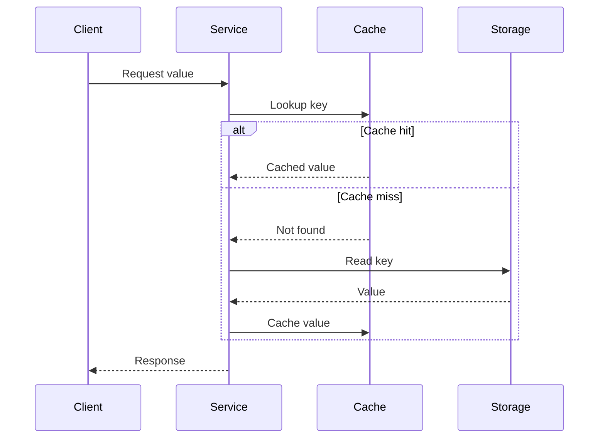
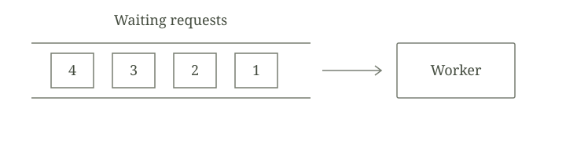

This is a **demonstration article**, included to show how writing on Loose Threads looks and works. Replace it with your first post, or set `draft: true` to hide it from the published site.

A request looks simple from the outside: send some bytes, wait for a response. Inside the system, those bytes pass through queues, cross boundaries, and compete for finite resources. Following one request is a useful way to make those hidden steps visible.

## Start with a small model

Imagine a client asking a service for a value. The service checks a cache, then reads from storage on a miss. We can describe that path in a few lines of TypeScript:

```typescript
interface Store {
  read(key: string): Promise<string | undefined>;
}

async function lookup(
  key: string,
  cache: Map<string, string>,
  store: Store,
): Promise<string | undefined> {
  const cached = cache.get(key);
  if (cached !== undefined) return cached;

  const value = await store.read(key);
  if (value !== undefined) cache.set(key, value);
  return value;
}
```

This is deliberately incomplete. A real cache needs decisions about expiry, capacity, and invalidation. The small model helps isolate the question: *which work does a cache hit avoid?*

> An abstraction is useful partly because of what it lets us ignore. Understanding a system means knowing when to look underneath it.

### Trace the boundaries

The diagram below is written in Mermaid and rendered to SVG during the build. It works with JavaScript disabled.



Even here, “storage” hides several layers. It might mean a local file, a database process on the same host, or another service across the network. The boundary matters more than the label.

## Account for the waiting

For a sequential request path, a simple accounting model is:

$$
T_{\text{request}} = T_{\text{network}} + T_{\text{queue}} + T_{\text{service}}
$$

The interesting term is often $T_{\text{queue}}$. A server can be quick at processing work while requests spend most of their time waiting to begin.

For a stable system, Little’s law relates the average number of requests in the system $L$, the average arrival rate $\lambda$, and the average time in the system $W$:[^little]

$$
L = \lambda W
$$

If a system completes 200 requests per second and a request spends an average of 0.05 seconds in the system, then $L = 200 \times 0.05 = 10$ requests on average. The units are part of the argument, not decoration.

## Make the tradeoffs explicit

A table is often enough to keep the comparison honest:

| Path | Work performed | Question to investigate |
| --- | --- | --- |
| Cache hit | Lookup and return | Is the cached value fresh enough? |
| Cache miss | Lookup, read, and fill | Can many misses arrive together? |
| Storage failure | Lookup, failed read | What does the caller observe? |

Before making the model more elaborate:

1. Identify the resource that does the work.
2. Separate time spent waiting from time spent executing.
3. State which failures and concurrent operations the model leaves out.

A useful measurement checklist might be:

- Arrival rate and completed requests per second
- Latency distribution, including the tail
- Queue depth and resource utilization
- Cache hit rate, expiry behavior, and failure rate

## Keep a picture nearby

Ordinary Markdown images work too. Store images beside your articles; Astro processes local image references and takes care of their deployed paths.



*The queue is part of the system, even when it is absent from the API.*

## Leave a thread to follow

The next question is what happens when several callers miss the cache for the same key at once. Do they all perform the same read? Should one caller do the work while others wait? What happens if that caller fails?

Those questions lead toward request coalescing, coordination, and the cost of shared state. A small request can take us a long way.

For the scope of this blog, see [About](../../about/). You can also return to [all writing](../../).

[^little]: The averages must describe the same stable system and the same observation boundary. See John D. C. Little’s [original paper on the queueing formula](https://doi.org/10.1287/opre.9.3.383) for the result and its conditions.
